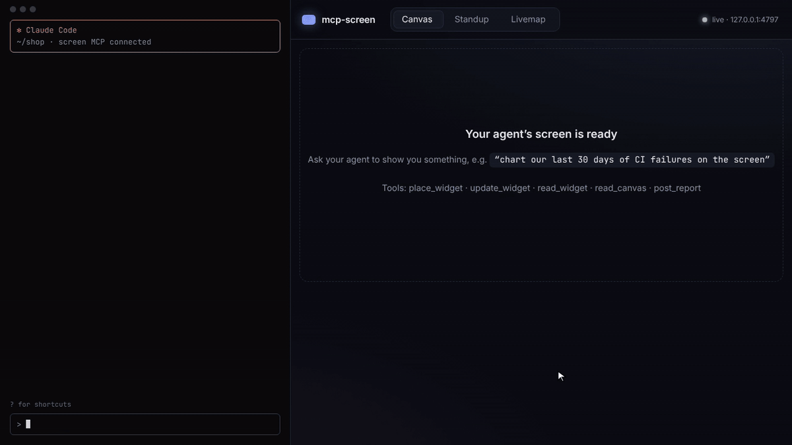
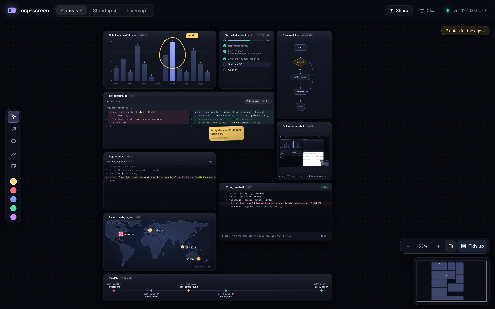
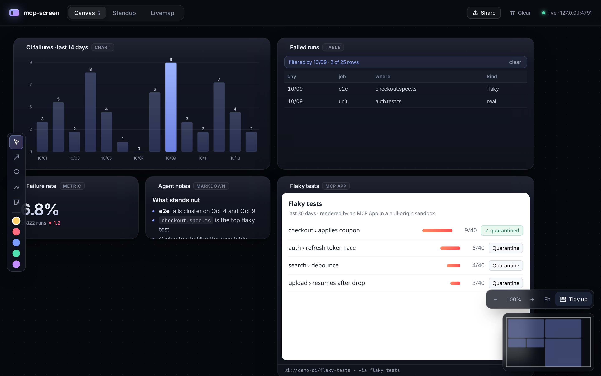
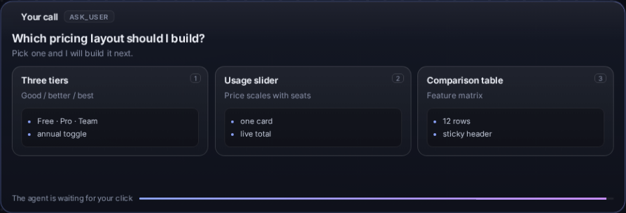
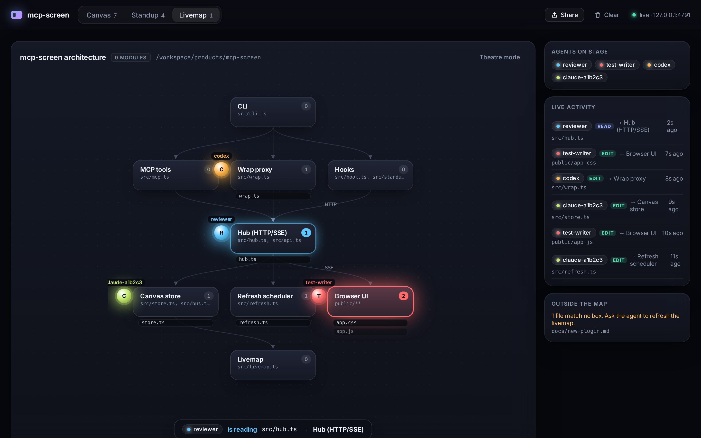
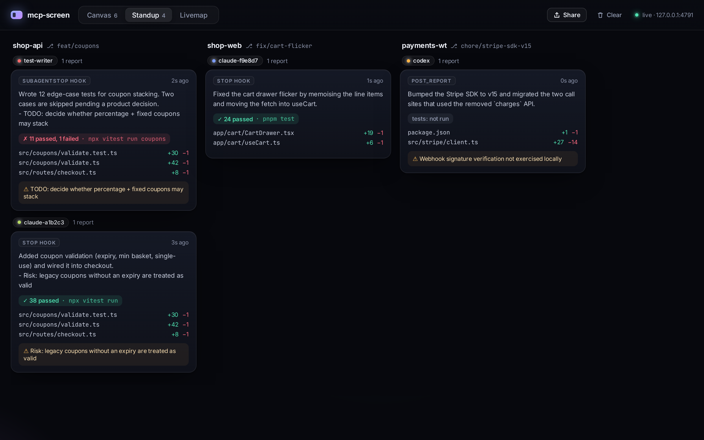
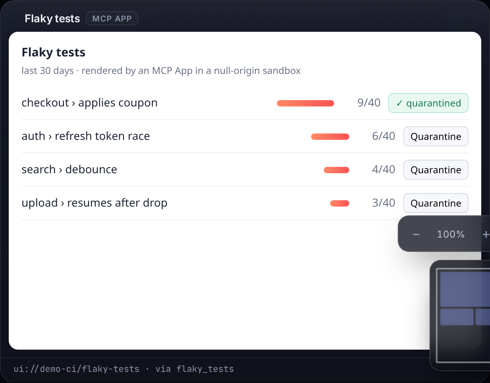
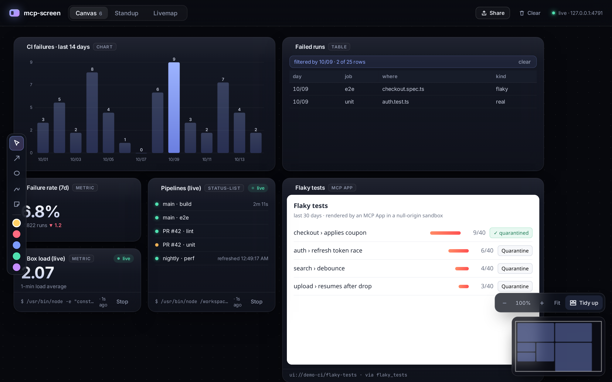
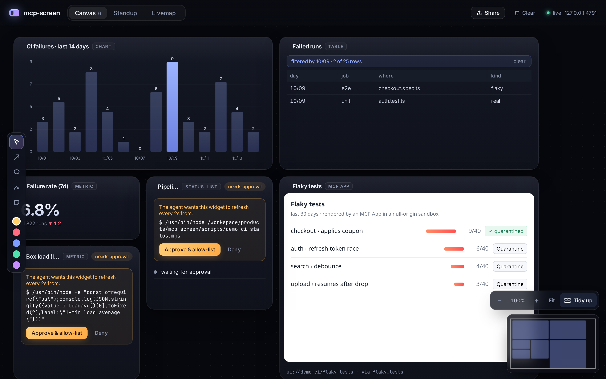

<div align="center">


### Your terminal agent can finally show you things.

Charts, tables, MCP Apps, visual questions and a live map of what your agents are doing, on a local canvas next to your terminal. One command.

[](https://github.com/ashark-ai-05/mcp-screen/actions/workflows/ci.yml) [](LICENSE) [](https://modelcontextprotocol.io) [](https://github.com/modelcontextprotocol/ext-apps) [](package.json)

```bash
claude mcp add screen -- npx mcp-screen
```



<sub>The terminal pane in the demo is **scripted** (it says so on screen): no model is running. Everything on the right is real: each widget comes from a real MCP tool call to a real mcp-screen process, the question card is a real blocking `ask_user` call answered by a real click, and the theatre is driven by real `PostToolUse` hook payloads sent through `mcp-screen hook` (`scripts/record-demo.mjs`, also as [demo.mp4](screenshots/demo.mp4)).</sub>

[Why](#why) · [Features](#features) · [Install](#install) · [Tools](#tools) · [Security](SECURITY.md) · [Contributing](CONTRIBUTING.md)

</div>

## Why

Claude Code, Codex, opencode, Amp, Cursor CLI and Gemini CLI live in a terminal, and a terminal can't show a chart, a table, or the UIs that MCP servers now ship as [MCP Apps](https://github.com/modelcontextprotocol/ext-apps). Those UIs reach a terminal agent as a wall of JSON, and when the agent needs a decision you get a numbered list to type back into.

mcp-screen opens a browser tab next to your terminal and gives the agent somewhere to put things, and gives you something to click. It runs entirely on your machine (`127.0.0.1`, token-protected, nothing uploaded).

## Features



<sub>One canvas, 17 widget kinds. The yellow circle ("why?") and the sticky note on the diff were drawn by a person; the agent reads them back with `read_canvas`, including the bar they point at. This screenshot comes from `scripts/e2e.mjs`.</sub>

<table>
<tr>
<td width="50%" valign="top">

**Canvas**<br>
`place_widget` charts, tables, metrics, markdown and status lists. Clicks flow back: the agent can `read_widget` and see the bar or row you picked.


</td>
<td width="50%" valign="top">

**Visual questions**<br>
`ask_user` puts choice cards on screen and blocks until you click one. The agent gets your choice back.


</td>
</tr>
<tr>
<td valign="top">

**Agent theatre**<br>
As agents read, edit and create files, their orbs glide across a live architecture map, files fly in and modules glow.


</td>
<td valign="top">

**Standup board**<br>
Claude Code `Stop`/`SubagentStop` hooks turn each finished run into a card: files changed, tests, summary, risks.


</td>
</tr>
<tr>
<td valign="top">

**MCP Apps for terminal agents**<br>
`mcp-screen wrap -- <server>` renders every `ui://` result in a null-origin sandbox.


</td>
<td valign="top">

**Live widgets**<br>
A widget can carry a command/URL/tool `source` that refreshes with no LLM in the loop, after you approve it.


</td>
</tr>
</table>

Plus **Share** (export the canvas as a PNG or one self-contained HTML file with no scripts) and **Clear** (with confirm and undo, or `clear_canvas` from the agent).

## Install

The canvas opens at <http://127.0.0.1:4747>. Several agent sessions share one canvas: the first one starts it and the others attach.

<details open>
<summary><b>Claude Code</b></summary>

```bash
claude mcp add screen -- npx mcp-screen
npx mcp-screen install-hooks --write   # optional: standup board + agent theatre
```
</details>

<details>
<summary><b>Codex</b></summary>

`codex mcp add screen -- npx mcp-screen`, or `~/.codex/config.toml`:

```toml
[mcp_servers.screen]
command = "npx"
args = ["mcp-screen"]
```
</details>

<details>
<summary><b>opencode</b></summary>

`opencode.json`:

```json
{
  "$schema": "https://opencode.ai/config.json",
  "mcp": { "screen": { "type": "local", "command": ["npx", "mcp-screen"] } }
}
```
</details>

<details>
<summary><b>Amp</b></summary>

`amp mcp add screen -- npx mcp-screen`, or `~/.config/amp/settings.json`:

```json
{ "amp.mcpServers": { "screen": { "command": "npx", "args": ["mcp-screen"] } } }
```
</details>

<details>
<summary><b>Cursor</b> (CLI and editor)</summary>

`~/.cursor/mcp.json`, or `.cursor/mcp.json` in a project:

```json
{ "mcpServers": { "screen": { "type": "stdio", "command": "npx", "args": ["mcp-screen"] } } }
```

Check it with `cursor-agent mcp list`. A project-level server may show as needing approval; run `cursor-agent mcp enable screen`.
</details>

<details>
<summary><b>Gemini CLI</b></summary>

```bash
gemini mcp add -s user screen npx mcp-screen     # writes mcpServers to ~/.gemini/settings.json
```

Gemini CLI disables MCP servers in folders you haven't trusted, so trust the project folder when it asks. `gemini mcp list` should show `screen` as Connected.
</details>

<sub>How these were checked (Oct 2026): opencode ran end to end with a free model. For Amp, Cursor CLI and Gemini CLI, the configs above were written (via `amp mcp add` and `gemini mcp add` for those two); Cursor (`cursor-agent mcp list-tools screen`) and Gemini (`gemini mcp list` → Connected) started the server and saw its tools. Prompting a model through Claude Code, Codex, Amp, Cursor and Gemini needs an account login, which we didn't do here.</sub>

## Tools

| Tool | What it does |
| --- | --- |
| `place_widget` | Put a widget on the canvas (kinds below). Optional `x`/`y` (world px), otherwise it goes in the first free slot. Optional `source` + `intervalMs` makes it live (needs your approval). |
| `update_widget` | Change a widget; shallow-merges `data` by default. `x`/`y` moves it. Logs take `data.append`, checklists take `data.set`. |
| `read_widget` | Read a widget, including your `selection` (clicked bar/row/node/marker, MCP App messages), your `annotations` on it, and a livemap's `unmappedFiles`. |
| `read_canvas` | List every widget (with `x`, `y`, `width`, `height`) and every annotation with its target widget and data points. |
| `remove_widget` | Remove one widget. |
| `clear_canvas` | Remove everything (`undo: true` brings it back). |
| `ask_user` | Show 2–8 choice cards and wait for your click; returns the choice, or `answered: false` with a reason. |
| `ask_form` | Show a small form (text, textarea, number, slider, select, checkbox) and wait for Submit; values are validated before the agent gets them. |
| `tidy_canvas` | Re-pack all widgets into a neat grid (same as the **Tidy up** button). |
| `post_report` | Add a card to the standup board. |

| kind | data |
| --- | --- |
| `markdown` | `{ markdown }` |
| `text` | `{ text }` (monospace) |
| `table` | `{ columns, rows }` (sortable; a row click becomes the selection) |
| `chart` | `{ type: "bar" \| "line", labels, values, unit?, linkTo? }` (a bar click becomes the selection and filters the linked table) |
| `metric` | `{ value, label?, delta? }` |
| `kv` | `{ items: { key: value } }` |
| `status-list` | `{ items: [{ label, status: ok \| fail \| pending \| unknown, detail? }] }` |
| `livemap` | `{ root?, nodes: [{ id, label, globs }], edges: [{ from, to }] }` |
| `code` | `{ code, language?, filename?, highlight?: [lines] }`: syntax highlighted, with a Copy button |
| `diff` | `{ before, after, path? }` or `{ patch }` (unified, multi-file): side-by-side / unified toggle |
| `diagram` | `{ mermaid }`: Mermaid **flowchart** subset (shapes, labelled edges, chains), laid out automatically |
| `image` | `{ path }` (absolute, local) or `{ url }` (https/data), `caption?` |
| `log` | `{ lines, maxLines?, wrap? }`: ANSI colours, error tints, sticks to the bottom; `data.append` adds lines; pair with a `command` source (e.g. `tail -n 200 file`) for a live tail |
| `checklist` | `{ items: [{ id, label, status: todo \| doing \| done \| failed \| skipped, detail? }] }`: progress bar; `data.set` flips statuses |
| `map` | `{ markers: [{ lat, lon, label, value?, color? }], bounds? }`: offline world map, no API key |
| `timeline` | `{ items: [{ at, title, status?, detail? }] }` |
| `form` | created by `ask_form` only |

### The canvas and your annotations

The canvas is infinite. **Pan** by dragging the background or scrolling, **zoom** with Ctrl/⌘+scroll or `+`/`−`, **F** fits everything, and **Tidy up** re-packs the grid. Drag a card by its header to move it; positions are kept by the hub and show up in `read_canvas`. The minimap (bottom right) jumps anywhere.

The left toolbar lets you talk back with ink: **arrow** (`A`), **circle** (`O`), **highlighter** (`H`) and **sticky note** (`N`), in five colours. Each mark is attached to the widget it lands on, plus the data points under it (bars, rows, log lines, diagram nodes, map markers, diff lines…), so the agent sees for example `{kind:"circle", text:"why?", target:{widgetId:"ci-chart", dataPoints:[{label:"10/09", value:9}]}}`. Select a mark and press Delete to remove it. It's deliberately not a whiteboard: marks exist to point the agent at things.

### ask_user

```jsonc
ask_user { "question": "Which pricing layout should I build?",
           "choices": [ { "id": "tiers", "label": "Three tiers", "description": "Good / better / best", "preview": "- Free · Pro · Team" },
                        { "id": "slider", "label": "Usage slider" } ],
           "timeoutSeconds": 180 }
// → { "answered": true, "choice": { "id": "tiers", "label": "Three tiers" }, "widgetId": "question-…" }
```

2 to 8 choices, each with an optional description and markdown preview. The call blocks (sending MCP progress notifications every 10 s) until you click, the timeout passes (default 3 min, max 15), the card is removed, or the agent cancels the call. It then returns `answered: false` with the reason.

### Agent theatre (livemap)

Ask: *"draw a livemap of this repo with place_widget, one box per module, with globs"*. Once the hooks are installed, every `Read`, `Write` and `Edit` plays out live: the agent's orb moves to the module, the file chip flies in and lands with a ripple, the box glows (blue for reads, warm for edits, a NEW badge for created files), and a caption says who is doing what. **Theatre mode** hides the side panel for a full-screen view. If you installed hooks before this version, re-run `install-hooks --write` so the `PostToolUse` matcher includes `Read`. `read_widget` on the map returns `unmappedFiles`, the edited files no box covers, so the agent knows when to redraw.

### MCP Apps (`wrap`)

```bash
claude mcp add flaky -- npx mcp-screen wrap -- node examples/demo-app-server.mjs
```

The agent sees the wrapped server's tools unchanged, plus the screen tools. When a tool declares `_meta.ui.resourceUri`, mcp-screen fetches the `ui://` resource and renders it on the canvas. The bridge handles `ui/initialize`, `tool-input` and `tool-result` notifications, `tools/call` and `resources/read` proxied back to the server, `ui/open-link`, `ui/message` and `ui/update-model-context`. Whatever the app reports becomes the widget's `selection`, so the agent can read it.

### Live widgets

```jsonc
place_widget { "kind": "status-list", "title": "Pipelines", "data": { "items": [] },
               "source": { "type": "command", "argv": ["gh", "run", "list", "--json", "..."], "parse": "json" },
               "intervalMs": 30000 }
```

The widget appears with an **Approve** button that shows the exact command. Nothing runs until you click it. Approved sources are saved to `~/.mcp-screen/allowlist.json`. Commands run without a shell, with a timeout and an output cap. **Stop** revokes the approval. See [SECURITY.md](SECURITY.md).



### Standup hooks

```bash
npx mcp-screen install-hooks --write   # merges Stop / SubagentStop / PostToolUse hooks into ./.claude/settings.json
                                       # (--local points them at a local checkout instead of npx)
```

When an agent or subagent stops, the hook reads `git diff --numstat` (plus untracked files) in its worktree. The summary and risks come from Claude Code's `last_assistant_message`. Subagent cards are named by `agent_type`, and the internal agents Claude Code runs (with an empty `agent_type`) are skipped. The hook also reads the transcript for the last test command and its result (vitest, jest, pytest, go and cargo output are parsed), falling back to the transcript for the summary if needed. These become a card. Agents can also call `post_report` themselves.

### CLI


```
mcp-screen                       stdio MCP server + canvas
mcp-screen wrap -- <cmd...>      proxy an MCP server and render its MCP Apps
mcp-screen serve                 canvas only
mcp-screen hook                  hook entry point (reads the hook JSON on stdin)
mcp-screen install-hooks [--write]
  --port <n>   (default 4747)    --no-open
```

## Develop

```bash
npm install
npm run build
npm test                # vitest unit tests, one file per part
npm run screenshots     # end-to-end: real stdio MCP client, hooks, Playwright screenshots + GIF
npm run demo            # records the launch demo: screenshots/demo.gif + demo.mp4 + hero.png
npm run interop         # renders the official ext-apps basic-server-vanillajs example through wrap
```

The design reuses pieces of [opencanvas](https://github.com/ashark-ai-05/opencanvas): the fan-out event bus, the widget-registry idea (kind → schema → renderer) and the null-origin plugin sandbox. It leaves out tldraw for a lighter grid canvas and a zero-build browser client.

See [CONTRIBUTING.md](CONTRIBUTING.md). The design reuses pieces of [opencanvas](https://github.com/ashark-ai-05/opencanvas): the fan-out event bus, the widget-registry idea (kind → schema → renderer) and the null-origin plugin sandbox. It leaves out tldraw for a lighter grid canvas and a zero-build browser client.

The UI uses the [Inter](https://rsms.me/inter/) variable font (SIL OFL 1.1, `public/fonts/LICENSE-Inter.txt`), bundled locally so nothing loads from the network.

## Status

v0.1, early. Known gaps: PNG export of an embedded MCP App shows a placeholder, because the sandboxed frame can't be captured; a single canvas per machine (no named canvases yet); MCP-tool live sources and app `tools/call` only work in the session that runs `wrap` and owns the canvas; no single-binary build yet.

## Security

mcp-screen binds to `127.0.0.1`, needs a per-run token, sandboxes MCP Apps in a null origin, and never runs a live source until you approve it. Details and known limits: [SECURITY.md](SECURITY.md).

---

<div align="center">

If mcp-screen helps your agent show its work, **[give it a star](https://github.com/ashark-ai-05/mcp-screen)** so other people can find it.

MIT © Krunal Ashar

</div>
