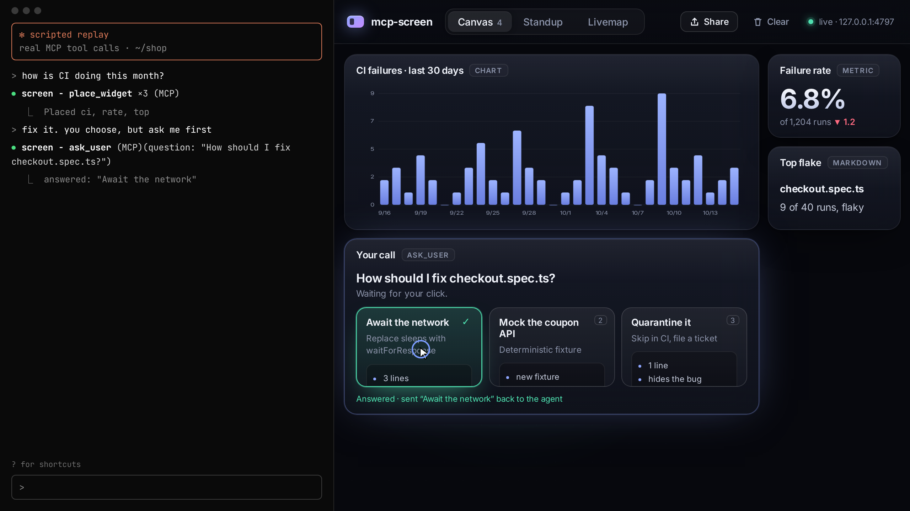
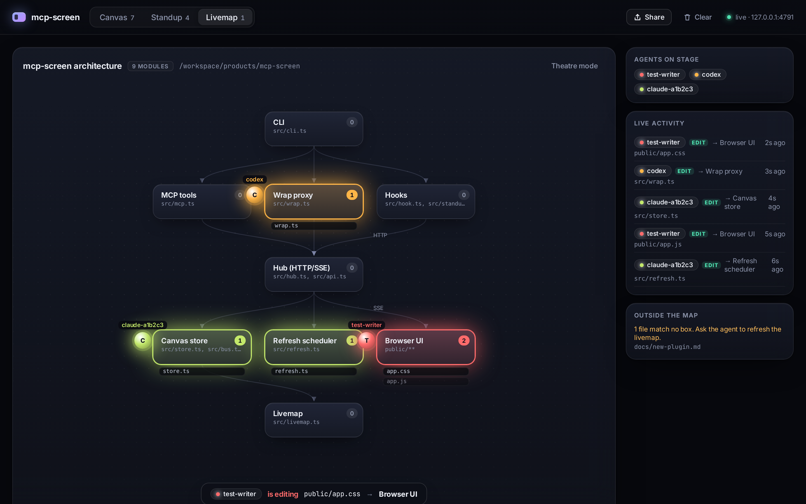

# mcp-screen



**Your terminal agent can finally show you things.** Any MCP App, any typed widget, live on a local canvas. One command.

```bash
claude mcp add screen -- npx mcp-screen
```

Claude Code, Codex, opencode, Amp, Cursor CLI and Gemini CLI live in a terminal, and terminals can't show charts, tables, or the UIs that MCP servers now ship as [MCP Apps](https://github.com/modelcontextprotocol/ext-apps). Today those UIs reach a terminal agent as a wall of JSON. mcp-screen opens a browser tab next to your terminal and gives the agent somewhere to put things.


<sub>The terminal pane in the demo is **scripted** (it says so on screen): no model is running. Everything on the right is real: each widget comes from a real MCP tool call to a real mcp-screen process, the question card is a real blocking `ask_user` call answered by a real click, and the theatre is driven by real `PostToolUse` hook payloads sent through `mcp-screen hook` (`scripts/record-demo.mjs`, also as [demo.mp4](screenshots/demo.mp4)).</sub>

One hub, these modes:

| Mode | What it does |
| --- | --- |
| **Canvas** | `place_widget`, `update_widget`, `read_widget` and `read_canvas`: charts, tables, metrics, markdown and status lists. `update_widget` shallow-merges by default. Clicks flow back, so the agent can `read_widget` and see the bar or row you picked. `clear_canvas` (or the **Clear** button, with confirm and undo) wipes it. |
| **Visual questions** | `ask_user` puts choice cards on the canvas and blocks until you click one (or it times out), then returns your choice to the agent. |
| **MCP Apps proxy** | `mcp-screen wrap -- <any MCP server>` passes the server's tools through and renders every `ui://` result in a null-origin sandbox, using the MCP Apps postMessage bridge. |
| **Live widgets** | A widget can carry a `source` (a command, URL or MCP tool) plus an interval. The server refreshes it with no LLM in the loop, and it keeps updating after the agent exits. Every source needs your explicit approval and goes on an allow-list. |
| **Standup board** | `post_report`, plus Claude Code `Stop`/`SubagentStop` hooks, turn each finished agent run into a card showing files changed, tests, a summary and risks. Cards are grouped by worktree and agent. |
| **Agent theatre** | The agent draws an architecture diagram (a livemap) whose boxes map to file globs. As agents `Read`, `Edit` or `Write` files, an orb per agent glides to the module, the file flies onto it and the box glows: blue for reads, warm for edits. |
| **Share** | Export the canvas as a PNG or as a single self-contained HTML file (no scripts, works offline). |

## Install

**Claude Code**

```bash
claude mcp add screen -- npx mcp-screen
```

**Codex** (`codex mcp add screen -- npx mcp-screen`, or `~/.codex/config.toml`)

```toml
[mcp_servers.screen]
command = "npx"
args = ["mcp-screen"]
```

**opencode** (`opencode.json`)

```json
{
  "$schema": "https://opencode.ai/config.json",
  "mcp": { "screen": { "type": "local", "command": ["npx", "mcp-screen"] } }
}
```

**Amp** (`amp mcp add screen -- npx mcp-screen`, or `~/.config/amp/settings.json`)

```json
{ "amp.mcpServers": { "screen": { "command": "npx", "args": ["mcp-screen"] } } }
```

**Cursor** (CLI and editor: `~/.cursor/mcp.json`, or `.cursor/mcp.json` in a project)

```json
{ "mcpServers": { "screen": { "type": "stdio", "command": "npx", "args": ["mcp-screen"] } } }
```

Then check it with `cursor-agent mcp list`. A project-level server may show as needing approval; run `cursor-agent mcp enable screen`.

**Gemini CLI**

```bash
gemini mcp add -s user screen npx mcp-screen     # writes mcpServers to ~/.gemini/settings.json
```

Gemini CLI disables MCP servers in folders you haven't trusted, so trust the project folder when it asks. `gemini mcp list` should show `screen` as Connected.

<sub>How these were checked (Oct 2026): opencode ran end to end with a free model. For Amp, Cursor CLI and Gemini CLI, the configs above were written (via `amp mcp add` and `gemini mcp add` for those two); Cursor (`cursor-agent mcp list-tools screen`) and Gemini (`gemini mcp list` → Connected) started the server and saw its tools. Prompting a model through Claude Code, Codex, Amp, Cursor and Gemini needs an account login, which we didn't do here.</sub>

The canvas opens at <http://127.0.0.1:4747>. Several agent sessions share one canvas: the first one starts it and the others attach.

## Canvas

Ask your agent something like *"compare our last 30 days of CI failures on the screen"*. It calls:

```jsonc
place_widget { "id": "ci", "kind": "chart", "title": "CI failures",
               "data": { "type": "bar", "labels": ["10/01", "10/02"], "values": [3, 5], "linkTo": "runs" } }
```

| kind | data |
| --- | --- |
| `markdown` | `{ markdown }` |
| `text` | `{ text }` (monospace) |
| `table` | `{ columns, rows }` (sortable; a row click becomes the selection) |
| `chart` | `{ type: "bar" \| "line", labels, values, unit?, linkTo? }` (a bar click becomes the selection and filters the linked table) |
| `metric` | `{ value, label?, delta? }` |
| `kv` | `{ items: { key: value } }` |
| `status-list` | `{ items: [{ label, status: ok \| fail \| pending \| unknown, detail? }] }` |
| `livemap` | `{ root?, nodes: [{ id, label, globs }], edges: [{ from, to }] }` |


Header actions: **Share** (PNG or self-contained HTML), **Clear** (asks first; an Undo toast brings everything back).

## Visual questions

```jsonc
ask_user { "question": "Which pricing layout should I build?",
           "choices": [ { "id": "tiers", "label": "Three tiers", "description": "Good / better / best", "preview": "- Free · Pro · Team" },
                        { "id": "slider", "label": "Usage slider" } ],
           "timeoutSeconds": 180 }
// → { "answered": true, "choice": { "id": "tiers", "label": "Three tiers" }, "widgetId": "question-…" }
```

2 to 8 choices, each with an optional description and markdown preview. The call blocks (sending MCP progress notifications every 10 s) until you click, the timeout passes (default 3 min, max 15), the card is removed, or the agent cancels the call. It then returns `answered: false` with the reason.


## MCP Apps for terminal agents

```bash
claude mcp add flaky -- npx mcp-screen wrap -- node examples/demo-app-server.mjs
```

The agent sees the wrapped server's tools unchanged, plus the screen tools. When a tool declares `_meta.ui.resourceUri`, mcp-screen fetches the `ui://` resource and renders it on the canvas. The bridge handles `ui/initialize`, `tool-input` and `tool-result` notifications, `tools/call` and `resources/read` proxied back to the server, `ui/open-link`, `ui/message` and `ui/update-model-context`. Whatever the app reports becomes the widget's `selection`, so the agent can read it.


## Live widgets

```jsonc
place_widget { "kind": "status-list", "title": "Pipelines", "data": { "items": [] },
               "source": { "type": "command", "argv": ["gh", "run", "list", "--json", "..."], "parse": "json" },
               "intervalMs": 30000 }
```

The widget appears with an **Approve** button that shows the exact command. Nothing runs until you click it. Approved sources are saved to `~/.mcp-screen/allowlist.json`. Commands run without a shell, with a timeout and an output cap. **Stop** revokes the approval. See [SECURITY.md](SECURITY.md).

| Waiting for approval | Live |
| --- | --- |
|  |  |

## Standup board

```bash
npx mcp-screen install-hooks --write   # merges Stop / SubagentStop / PostToolUse hooks into ./.claude/settings.json
                                       # (--local points them at a local checkout instead of npx)
```

When an agent or subagent stops, the hook reads `git diff --numstat` (plus untracked files) in its worktree. The summary and risks come from Claude Code's `last_assistant_message`. Subagent cards are named by `agent_type`, and the internal agents Claude Code runs (with an empty `agent_type`) are skipped. The hook also reads the transcript for the last test command and its result (vitest, jest, pytest, go and cargo output are parsed), falling back to the transcript for the summary if needed. These become a card. Agents can also call `post_report` themselves.


## Agent theatre (livemap)

Ask: *"draw a livemap of this repo with place_widget, one box per module, with globs"*. Once the hooks are installed, every `Read`, `Write` and `Edit` plays out live: the agent's orb moves to the module, the file chip flies in and lands with a ripple, the box glows (blue for reads, warm for edits, a NEW badge for created files), and a caption says who is doing what. **Theatre mode** hides the side panel for a full-screen view. If you installed hooks before this version, re-run `install-hooks --write` so the `PostToolUse` matcher includes `Read`. `read_widget` on the map returns `unmappedFiles`, the edited files no box covers, so the agent knows when to redraw.

| Theatre | Many agents |
| --- | --- |
|  |  |

## CLI

```
mcp-screen                       stdio MCP server + canvas
mcp-screen wrap -- <cmd...>      proxy an MCP server and render its MCP Apps
mcp-screen serve                 canvas only
mcp-screen hook                  hook entry point (reads the hook JSON on stdin)
mcp-screen install-hooks [--write]
  --port <n>   (default 4747)    --no-open
```

## Develop

```bash
npm install
npm run build
npm test                # vitest unit tests, one file per part
npm run screenshots     # end-to-end: real stdio MCP client, hooks, Playwright screenshots + GIF
npm run demo            # records the launch demo: screenshots/demo.gif + demo.mp4 + hero.png
npm run interop         # renders the official ext-apps basic-server-vanillajs example through wrap
```

The design reuses pieces of [opencanvas](https://github.com/ashark-ai-05/opencanvas): the fan-out event bus, the widget-registry idea (kind → schema → renderer) and the null-origin plugin sandbox. It leaves out tldraw for a lighter grid canvas and a zero-build browser client.

The UI uses the [Inter](https://rsms.me/inter/) variable font (SIL OFL 1.1, `public/fonts/LICENSE-Inter.txt`), bundled locally so nothing loads from the network.

## Status

v0.1, early. Known gaps: PNG export of an embedded MCP App shows a placeholder, because the sandboxed frame can't be captured; a single canvas per machine (no named canvases yet); MCP-tool live sources and app `tools/call` only work in the session that runs `wrap` and owns the canvas; no single-binary build yet.

## License

MIT
